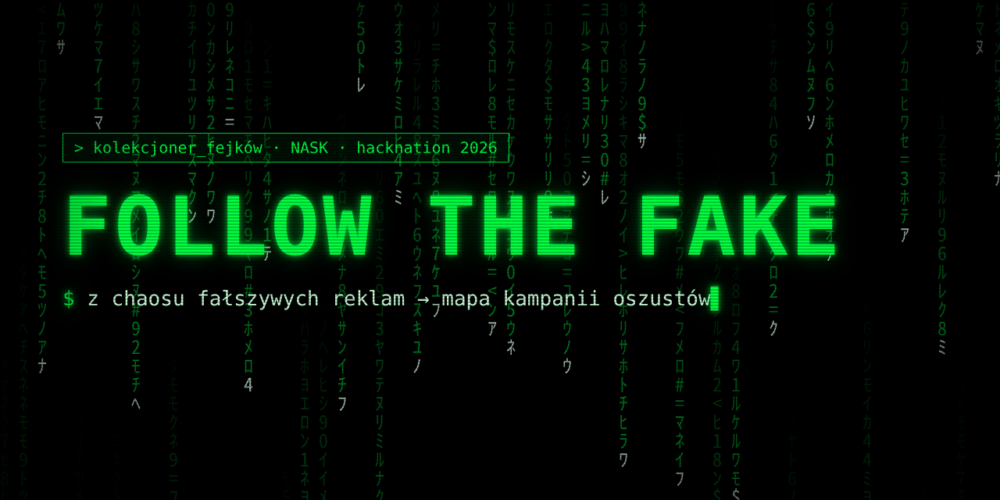
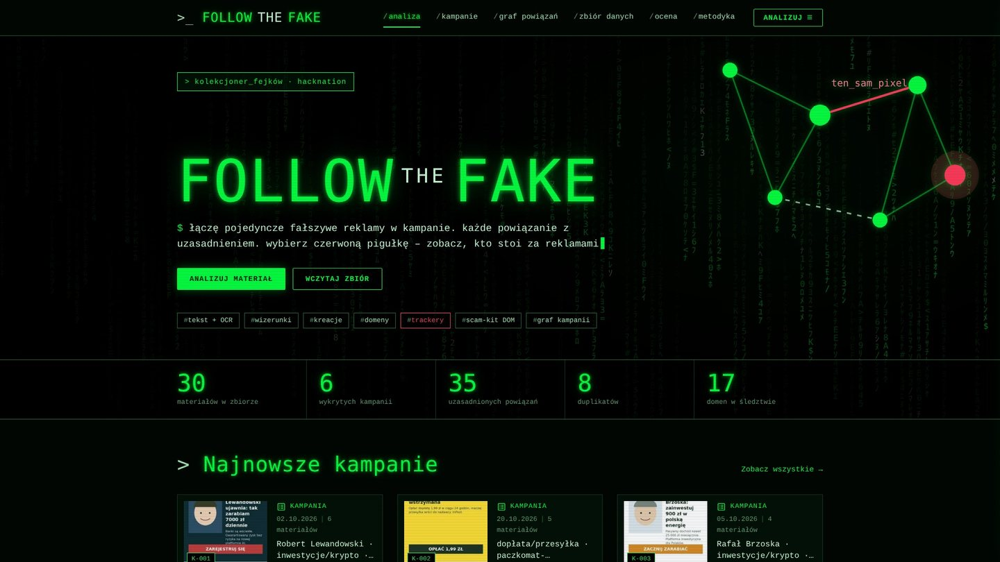
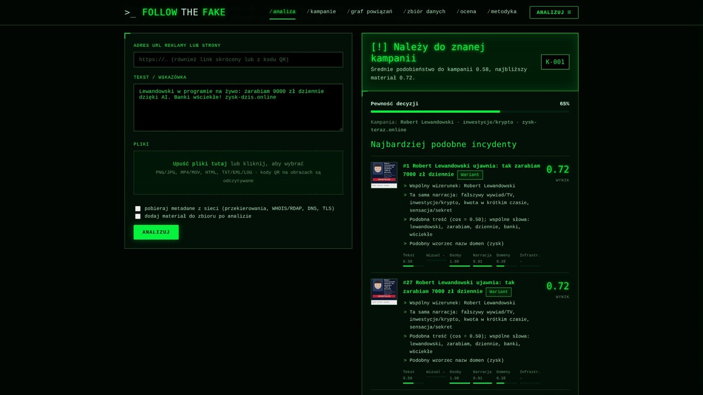
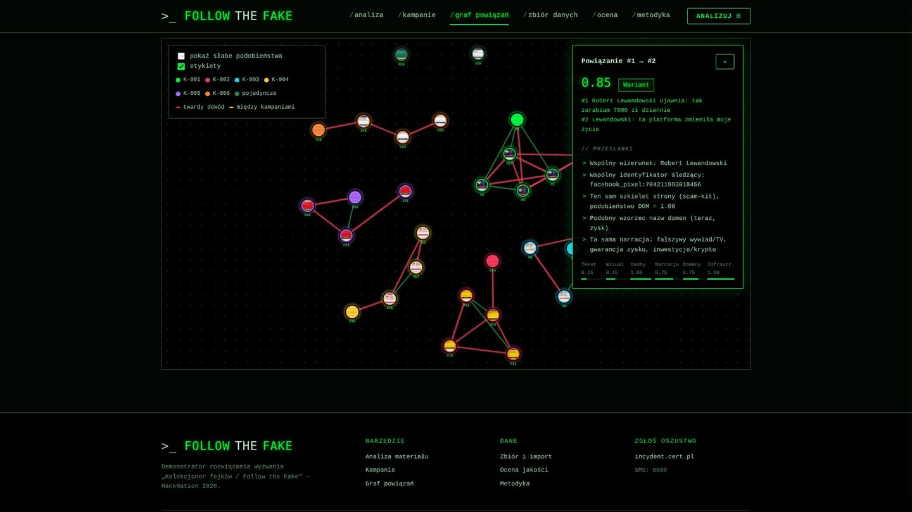
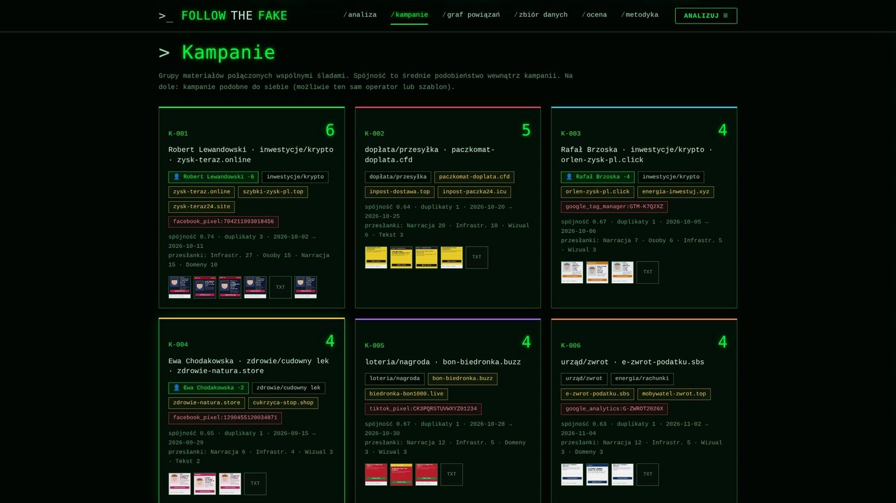
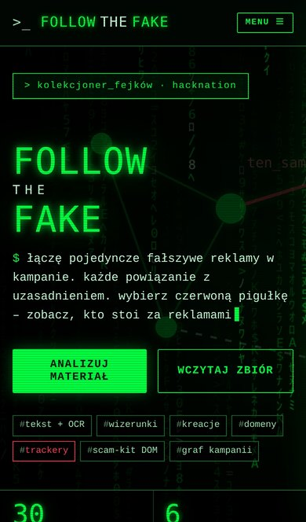
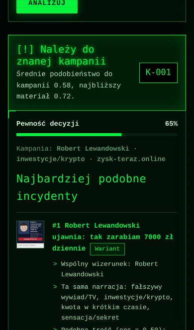
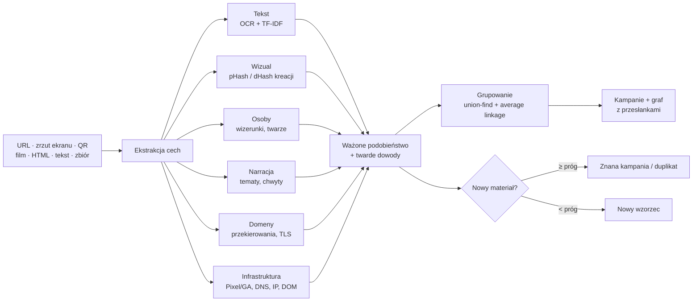

<p align="center">
  
</p>

<p align="center">
  
  
  
</p>
<p align="center">
  
  
  
  
  
</p>

```text
$ ./follow --the-fake
> pojedyncza reklama mówi mało. kampania pokazuje źródło.
> 6 kanałów śladów · ważone podobieństwo · twarde dowody · każde powiązanie z uzasadnieniem_
```

Fałszywe reklamy z wizerunkami znanych osób znikają po kilku godzinach i wracają pod nowymi domenami. Pojedyncze zgłoszenie niewiele mówi. Dopiero zestawienie wielu reklam pokazuje **wspólnego operatora**: ten sam piksel śledzący, ten sam szkielet strony, ten sam wizerunek, tę samą obietnicę zysku.

**Follow the Fake** robi to automatycznie. Przyjmuje link, zrzut ekranu (również z kodem QR), film, stronę HTML albo cały zbiór reklam. Wyciąga z nich ślady, łączy materiały w **kampanie** i przy każdym połączeniu pokazuje **dlaczego**.

---

## ⚡ Szybki start

> **Windows:** dwuklik na **`START.bat`** → przeglądarka otworzy `http://localhost:8000` → zakładka **„Zbiór danych”** → **„Wczytaj zbiór demonstracyjny”**.

```bash
# Docker (zawiera OCR z językiem polskim)
docker compose up --build            # → http://localhost:8000

# Linux / macOS
./start.sh

# ręcznie
python -m venv .venv && .venv/bin/pip install -r requirements.txt && .venv/bin/python app.py
```

Wymagania: Python 3.10+. Opcjonalnie Tesseract OCR z pakietem `pol`. **Żadne klucze API nie są potrzebne.**

---

## 🖥️ Jak to wygląda

<table>
  <tr>
    <td width="50%"><br><sub><b>Start</b> – statystyki zbioru i najnowsze kampanie</sub></td>
    <td width="50%"><br><sub><b>Analiza</b> – znana kampania / duplikat / nowy wzorzec + przesłanki</sub></td>
  </tr>
  <tr>
    <td width="50%"><br><sub><b>Graf powiązań</b> – każda krawędź ma uzasadnienie, czerwone = twardy dowód</sub></td>
    <td width="50%"><br><sub><b>Kampanie</b> – wizerunki, domeny, trackery, okres aktywności, spójność</sub></td>
  </tr>
</table>

<p align="center">
  
  &nbsp;&nbsp;
  
  <br><sub>Strona działa też na telefonie, jest też osobna aplikacja mobilna (<code>mobile/</code>).</sub>
</p>

---

## 🧬 Jak to działa



### 6 kanałów śladów

| # | Kanał | Co porównujemy | Waga |
|---|---|---|---|
| 01 | **Tekst** | OCR + tekst strony, TF-IDF słów i n-gramów znakowych (odporne na odmianę i literówki) | 0.26 |
| 02 | **Wizual** | pHash i dHash **samej kreacji wyciętej ze zrzutu** (bez ramki Facebooka/Instagrama), paleta barw | 0.20 |
| 03 | **Osoby** | wizerunki z bazy referencyjnej, hashe wycinków twarzy | 0.12 |
| 04 | **Narracja** | tematy (krypto, dopłata do paczki, „cudowny lek”…), chwyty manipulacyjne, marki | 0.10 |
| 05 | **Domeny** | wspólne domeny, węzły w łańcuchu przekierowań, nazwy w certyfikatach TLS, wzorce nazw | 0.14 |
| 06 | **Infrastruktura** | Facebook Pixel / GA / GTM / TikTok, favicon, IP, serwery DNS, rejestrator i data, **szkielet DOM (scam-kit)** | 0.18 |

```text
wynik = Σ wₖ·sₖ / Σ wₖ           ← tylko kanały dostępne w OBU materiałach
        × (0.6 + 0.4·pokrycie)    ← brak danych ≠ różnica, ale niskie pokrycie lekko karze
twardy dowód (ten sam Pixel, portfel, domena, identyczna kreacja…) → wynik ≥ 0.85
```

Każde połączenie dostaje listę przesłanek, np.:

```text
#1 ↔ #2   0.85  WARIANT
  > Wspólny wizerunek: Robert Lewandowski
  ! Wspólny identyfikator śledzący: facebook_pixel:704211993018456
  > Ten sam szkielet strony (scam-kit), podobieństwo DOM = 1.00
  > Podobny wzorzec nazw domen (teraz, zysk)
```

Pełny opis: **[METODYKA.md](METODYKA.md)** (również w zakładce *Metodyka* w aplikacji).

---

## 🧪 Wyniki

| Test | Wynik |
|---|---|
| Grupowanie zbioru demo (30 materiałów, 6 kampanii + 3 legalne) | ARI **1.00** · F1 par **1.00** · B-cubed **1.00** |
| Nowe materiały: warianty znanych kampanii, nowa kampania, 3 reklamy-pułapki | **10 / 10** |
| Podwójny import tego samego zbioru (odporność na duplikaty) | te same kampanie, duplikaty oznaczone |

> ⚠️ Zbiór demonstracyjny jest **syntetyczny** (`tools/make_demo.py`) i łatwiejszy od prawdziwych danych. Wyniki pokazują, że metoda działa zgodnie z założeniami, a nie jaka będzie skuteczność na zbiorze organizatora. Do oceny na prawdziwym zbiorze:
>
> ```bash
> python tools/evaluate_dataset.py <folder | zbior.zip | dane.csv> [--network]
> python tools/holdout_test.py
> ```

---

## 🗂️ Co potrafi

- **Wejście:** URL (również skrócony lub z kodu QR), tekst / log komunikacji / nazwa produktu, zrzut ekranu, kreacja, **wideo**, zapisana strona **HTML**, TXT/EML/LOG, cały zbiór **ZIP / JSON / JSONL / CSV** (nazwy pól rozpoznawane automatycznie).
- **Śledztwo URL:** przekierowania HTTP + meta-refresh + JS, RDAP (rejestrator, data, DNS), IP i sieć, certyfikat TLS, crt.sh, favicon, trackery, formularze z polami wrażliwymi (karta, CVV, BLIK).
- **Podszywanie się:** marka w tytule strony, a domena obca, np. „NASK | Program lojalnościowy” na cudzej domenie.
- **Duplikaty i warianty**, **kampanie podobne** (ten sam operator, inna narracja).
- **Nowy materiał** → *duplikat* / *znana kampania* / *nowy wzorzec*, z pewnością i rankingiem kampanii.
- **Ocena jakości:** ARI, NMI, F1 par, B-cubed, test przypisywania nowych materiałów (leave-one-out).
- **Eksport:** Neo4j (Cypher z uzasadnieniem każdej krawędzi), CSV, JSON.
- **Harmonogram:** skanowanie **Biblioteki Reklam Meta** po słowach kluczowych + ponowne sprawdzanie znanych domen.
- **Odporność na braki:** niedziałające strony, brak obrazu, brak metadanych – kanał jest pomijany, a nie liczony jako różnica.

---

## 📱 Aplikacja mobilna

```bash
# 1. serwer:  START.bat
# 2. aplikacja:
mobile/MOBILE.bat        # tworzy projekt Expo, instaluje biblioteki, pokazuje kod QR
```

Zeskanuj kod w **Expo Go**, a w aplikacji wpisz w *Ustawieniach* adres komputera (np. `http://192.168.1.23:8000`). Aplikacja robi to samo co strona: zrzut z rolki prosto z telefonu → wynik z przesłankami → zgłoszenie do CERT Polska.

---

## ⚙️ Konfiguracja

| Zmienna | Znaczenie |
|---|---|
| `PORT`, `HOST` | port i interfejs serwera (domyślnie `8000`, `0.0.0.0`) |
| `FTF_DB` | ścieżka bazy SQLite (domyślnie `data/ftf.sqlite`) |
| `OCR_LANGS`, `TESSERACT_CMD` | języki OCR (`pol+eng`) i ścieżka do `tesseract.exe` |
| `ANTHROPIC_API_KEY` | *opcjonalnie:* opis kreacji modelem wizyjnym (tekst, osoby, logotypy) |
| `META_ACCESS_TOKEN` | *opcjonalnie:* token Ad Library API dla harmonogramu |

Rozpoznawanie twarzy (opcjonalne): `python tools/download_models.py` + zdjęcia w `data/faces/<Imię Nazwisko>/`.

<details>
<summary><b>📥 Format danych do importu</b></summary>

Manifest JSON (`{"items":[…]}` lub lista), JSONL albo CSV (separator `,` `;` lub tab). Rozpoznawane pola:

| Rola | Nazwy pól |
|---|---|
| tekst | `text`, `body`, `ad_creative_bodies`, `description`, `caption` |
| URL | `url`, `link`, `landing_url`, `link_url` |
| plik | `image`, `screenshot`, `file`, `video`, `html` (ścieżka w ZIP/folderze) |
| etykieta | `label`, `campaign`, `cluster` |
| data / id | `date`, `ad_delivery_start_time` / `id`, `ad_id` |
| metadane | `meta: {trackers, nameservers, ips, registrar, created, …}` |

Folder bez manifestu też zadziała: każdy plik to osobny materiał.
</details>

<details>
<summary><b>🔌 API</b></summary>

| Metoda | Ścieżka | Opis |
|---|---|---|
| `POST` | `/api/analyze` | analiza materiału `{url, text, files[], network, save}` |
| `POST` | `/api/import` | import zbioru `{zip_b64 \| raw, name, network}` |
| `POST` | `/api/demo` | wczytanie zbioru demonstracyjnego |
| `GET` | `/api/state` | statystyki, kampanie, materiały |
| `GET` | `/api/graph` | węzły i krawędzie z przesłankami |
| `GET` | `/api/item/<id>` | pełne cechy materiału + sąsiedzi |
| `GET` | `/api/evaluate` | miary jakości (gdy są etykiety) |
| `GET` | `/api/export/graph.cypher` | eksport do Neo4j |
| `GET` | `/api/export/{materialy.csv, powiazania.csv, wyniki.json}` | eksport tabel i wyników |
| `GET/POST` | `/api/scheduler`, `/api/scheduler/run` | harmonogram skanowania |
</details>

<details>
<summary><b>🧱 Struktura projektu</b></summary>

```text
app.py                 serwer WWW + API (biblioteka standardowa)
ftf/extract.py         ujednolicony rekord cech z dowolnego wejścia
ftf/infra.py           przekierowania, HTML, trackery, DOM, RDAP, DNS, TLS, crt.sh
ftf/visual.py          hashe percepcyjne, wycinanie kreacji, OCR, QR, twarze, wideo
ftf/lexicon.py         osoby, marki, tematy, chwyty manipulacyjne
ftf/engine.py          podobieństwo, duplikaty, grupowanie, przypisanie nowych
ftf/evaluate.py        miary jakości
ftf/importer.py        import zbiorów (ZIP/JSON/JSONL/CSV/folder)
ftf/scheduler.py       Biblioteka Reklam Meta + ponowne sprawdzanie domen
ftf/export.py          Neo4j Cypher, CSV, JSON
static/                interfejs WWW (HTML/CSS/JS bez zależności)
mobile/                aplikacja mobilna (Expo / React Native)
tools/                 zbiór demo, ocena, test hold-out, modele twarzy
```
</details>

<details>
<summary><b>📜 Biblioteki, modele, usługi i licencje</b></summary>

| Komponent | Zastosowanie | Licencja |
|---|---|---|
| Python (stdlib) | serwer, sieć, SQLite | PSF |
| NumPy · scikit-learn | obliczenia, TF-IDF, klastrowanie, miary | BSD-3 |
| Pillow | obrazy, hashe percepcyjne | MIT-CMU (HPND) |
| OpenCV | QR, wideo, twarze | Apache 2.0 |
| Tesseract OCR *(opcjonalny)* | OCR pol+eng | Apache 2.0 |
| YuNet, SFace – OpenCV Zoo *(opcjonalne)* | wykrywanie i rozpoznawanie twarzy | Apache 2.0 |
| JetBrains Mono, Share Tech Mono | czcionki interfejsu | SIL OFL 1.1 |
| Expo, React Native, expo-image-picker, AsyncStorage | aplikacja mobilna | MIT |
| rdap.org, crt.sh | metadane domen i certyfikatów | usługi publiczne, bez klucza |
| Meta Ad Library API *(opcjonalne)* | harmonogram | token + regulamin Meta |
| Anthropic Claude API *(opcjonalne)* | opis kreacji | klucz API, płatne za użycie |
</details>

---

## 👾 Zespół

<p align="center">
  <b>MORFEUSZ</b> · stolik <b>11G</b> · Piotr Jarosz<br>
  <sub>Wyzwanie „Kolekcjoner fejków / Follow the Fake” – NASK PIB · HackNation 2026</sub>
</p>

```text
> widzisz podejrzaną reklamę? zgłoś ją: https://incydent.cert.pl
> // projekt zespołu startującego w HackNation – nie jest oficjalnym narzędziem NASK ani CERT Polska.
> // materiały organizatora nie są dołączone do repozytorium; zbiór demo jest syntetyczny.
```
